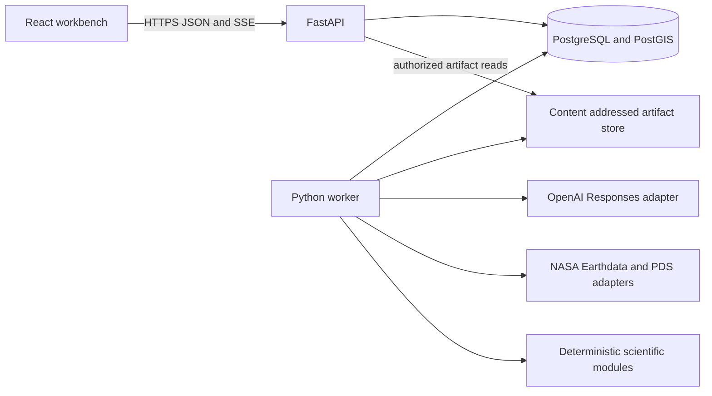

# System architecture

Build a web workbench, a typed HTTP API, and a durable scientific worker around one PostgreSQL database and a content-addressed artifact directory. This topology keeps expensive raster analysis independent of browser and API lifetimes while preserving a single durable record of decisions.

## Component boundaries

The API validates requests, resolves authorization, appends commands, and returns persisted read models. It never runs the route search inline. The worker claims commands, executes the state machine and scientific tools, writes artifacts atomically, then commits immutable results and events. The browser renders committed state; animations cannot create results.

## Request to result

1. `POST /api/v1/runs` validates accepted mission revision, rover revision, workspace, mode, and configuration. Create the run, first job, and event in one transaction. Return HTTP 202 plus run/job IDs.
2. Worker leases the job and loads exact input hashes. It validates prerequisites, invokes the next role, executes only allowed tool calls, and persists their receipts.
3. A tool either returns typed evidence with artifact hashes, or a typed operational error. Tool failures never return plausible values.
4. A deterministic policy service checks the role proposal, current run revision, receipt existence, and constraints. It commits the transition with new evidence/result references and a run event.
5. SSE delivers committed events. Frontend invalidates relevant query caches and refetches the authoritative snapshot.
6. At a human review gate, the worker releases its lease after persisting the pending decision. A user action schedules continuation. It does not hold a process waiting for the browser.

## Layering

`api` depends on application services; services depend on domain contracts and repositories; science depends on typed arrays and scientific metadata; provider adapters depend on HTTP clients or filesystem interfaces. Domain and science modules must not import FastAPI, frontend types, or OpenAI SDK classes. Agent code cannot execute SQL or arbitrary shell commands. Application services call repositories using a workspace-scoped unit of work.

The pipeline is not an LLM-only loop. Explicit transitions and permission gates remain in ordinary code. Model roles select investigations within this policy and produce bounded, validated proposals. The scientific verifier is independently callable without any model.

## Resource and failure isolation

Each CPU task executes in a subprocess with a wall-clock and memory budget. A worker coordinates no more than two CPU subprocesses initially; leave API capacity available. Cache processed tiles by source checksums, CRS, extent, scale, and algorithm parameters. A cache hit preserves original evidence lineage but adds a current invocation receipt.

Network adapters apply connection/read timeouts, bounded retries, host allowlists, byte limits, and redirect validation. A provider outage produces a resumable blocked dependency or retryable job, not an empty candidate set interpreted as scientific failure.

## Persistence and consistency

A database transaction assigns a run-local event sequence while locking the run row. Notifications are advisory; the event table is the source of truth. Workers use lease tokens as fencing tokens so expired workers cannot publish late results. Artifact files are fully written, hashed, and atomically renamed before any database reference is committed.

There is no distributed transaction with a provider. Model invocations may repeat after a crash; deterministic tool outputs are deduplicated by input hash. Provider cost and duplicate call risk are recorded. The system guarantees idempotent result publication, not exactly-once external billing.

## Deployment profiles

- Developer: Compose API, worker, database, and frontend development server, with local artifact volume. Synthetic runs need no external account.
- Rehearsal: production frontend build served by API or reverse proxy, real locked data, precomputed replay available and labeled.
- Hosted: HTTPS reverse proxy, API/worker containers, private PostgreSQL, persistent volumes, OIDC login, quota and resource controls. Multiple workers may share the same database and storage.

Sites/static hosting may serve the frontend only. The Python/GDAL worker needs a container/server capable of native scientific packages and persistent storage. No hosting vendor account is required to author or run this specification locally.

## Acceptance

Kill the API during a run, reconnect, and recover state/events. Kill a worker mid-analysis and let its lease expire; a replacement must complete without publishing duplicate results. Disable OpenAI and run deterministic unit verification. Run the synthetic scenario with external networking disabled. Verify no browser network request carries a provider secret.
