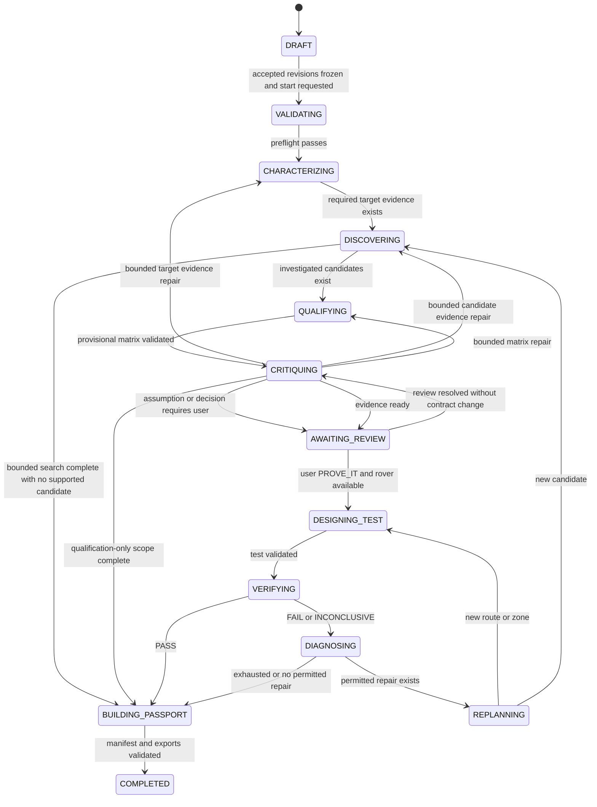

# Agent orchestration: ten roles, one controlled workflow

## Implementation boundary

The Mission Council is ten role configurations using the same server-side OpenAI Responses API model, selected by `OPENAI_MODEL`. It is not ten independent long-running chatbots. The Python worker owns scheduling, graph transitions, persistence, retries, and scientific computation. A role receives a bounded task, calls only its registered tools, and submits a structured proposal. Backend policy validates and commits that proposal. Neither a model sentence nor a tool-call request is a scientific result.

Implement under the repository layout in `04-REPOSITORY-AND-DEPENDENCIES.md`: `src/analogforge/agents/runtime/`, `agents/roles/`, `agents/schemas/`, `domain/policy/`, `application/runs/`, and `jobs/handlers/`. Role execution belongs in agents/runtime, transition policy in domain/policy, and durable dispatch in jobs. These are proposed implementation paths, not existing code. The source of truth is `00-ARCHITECTURE-DECISIONS.md` and `contracts/domain.schema.json`; `15-TOOL-REGISTRY-AND-PROMPT-CONTRACT.md` defines the model boundary. Per-role specifications are in `agents/01-mission-director.md` through `agents/10-evidence-passport.md`.

## Responsibilities and ownership

| Role key | Owned proposal | May not decide alone |
|---|---|---|
| `mission_director` | Next permitted investigation and stop reason | User acceptance, scientific PASS, arbitrary state jump |
| `requirements` | Draft mission contract and unresolved assumptions | Acceptance of invented exposure thresholds |
| `rover_systems` | Parsed capability interpretation and benchmark feasibility | Hardware readiness, unknown clearance, measured power |
| `planetary_target` | Evidence acquisition and characterization requests | Numbers absent from tool evidence |
| `earth_scout` | Bounded candidate investigation and shortlist | Global optimality or qualification from reputation |
| `qualification` | Requirement-level interpretation and proposed matrix | Commit of PASS or replacement of evidence |
| `scientific_critic` | Specific objections and bounded repair requests | Veto forever, relax requirements, fabricate counterevidence |
| `test_designer` | A benchmark and route search specification | User requirement changes or route certification |
| `verification_replanning` | Failure explanation and permitted repair | Rewrite computed verdict or guarantee infeasibility |
| `evidence_passport` | Claim-to-evidence report assembly | Omitting negative results or declaring flight certification |

Only the mission API acceptance endpoint records user acceptance of a contract revision. Rover create/revise endpoints save validated immutable revisions; a run selects a saved revision without a separate rover acceptance endpoint. Only deterministic evaluators can create quantitative scientific outputs. Only the policy service may advance the run state or commit qualification/verification decisions. A role can request a data processing job through a tool, but it cannot execute shell code, unrestricted Python, arbitrary SQL, or arbitrary network requests.

## Immutable run context

Before run creation, Requirements drafting uses the separate PreparationJob context in document 15; no run UUID or scientific evidence is fabricated for a draft. After the user accepts the contract and starts execution, persist: `workspace_id`, `run_id`, `mode`, accepted `mission_revision_id`, saved `rover_revision_id` (nullable for qualification-only runs), `target_revision_id`, canonical SHA-256 hashes of those revisions, prompt bundle hash, tool-registry version, algorithm version bundle, model identifier, allowed source policy revision, budgets, and accepted-assumption IDs. Every invocation, tool receipt, evidence item, test, and report inherits this context. Execution runs always reference an accepted mission revision and an optional saved rover revision; DRAFT is the initial created-run state before validation, not the natural-language fingerprint preparation job. `VALIDATING` requires the accepted mission hash. A qualification-only run may omit a rover; PROVE_IT requires one and cannot backfill a changed immutable run context.

Runtime mode is immutable:

- `live`: approved real datasets and live model calls. Missing provider credentials or required source data creates actionable blocked work; never insert a synthetic fallback.
- `replay`: use checksummed recorded decisions, evidence, and artifacts. Reproduce the original sequence or inspect it; no new model output is presented as recorded. A new live investigation requires a new live run.
- `synthetic`: use analytic rasters and scripted role results, with all network/provider clients disabled. Every panel and export preserves the mode. Never cite a NASA collection as the source of synthetic pixels.

The run's `dataset_lock_id` freezes a source-policy lock: approved product families, exact product versions, query extents, decoder/quality policy and existing seed assets. It does not prohibit discovering and fetching additional eligible granules. Each newly acquired granule appends to the immutable per-run asset manifest, and every derived evidence item pins exact input hashes. Passport assembly freezes the final asset-manifest hash. Replacing an already selected source version or changing policy requires a new run; adding an allowed granule does not.

A live run can reuse a real, checksummed artifact originally fetched in another live run when its full derivation and license policy match. Record the reuse. A replay run can reference recorded real evidence but retains a replay label on the run and outputs. Cross-mode evidence references are denied except the explicit replay reference to an immutable source-run manifest; they do not convert mode.

## State graph and entry conditions

Use exactly the run states defined in the decision register. Job execution status is separate. A run can be `CHARACTERIZING` while its job is queued or retried. The scheduler is code; it takes a role proposal only as an input.

Additional transitions are policy controlled: any active state may enter `CANCELLED` after cancellation acknowledgement, `BLOCKED` for a dependency requiring intervention, or `FAILED` for an unrecoverable system failure. A budget/data-limited state may transition to BUILDING_PASSPORT only when a deterministic partial report can preserve every unresolved requirement and stop reason; it never changes scientific outcomes to manufacture completion. A blocked run resumes through the RETRY action only to its persisted `resume_state` after the dependency is resolved and the immutable context still validates. Contract/rover changes create a new run, not a backwards transition on the existing run. `COMPLETED` means the investigation and report completed; it can contain FAIL, GAP, UNKNOWN, or INCONCLUSIVE scientific outcomes.

Entry gates:

1. `VALIDATING`: schema-valid accepted mission, optional saved rover, explicit mode, accepted assumptions, provider preflight for live, budget reservation.
2. `CHARACTERIZING`: target body, geometry, source CRS and datum validated; approved product coverage identified.
3. `DISCOVERING`: contract feature set and comparable target measurements or explicit unknown dimensions exist.
4. `QUALIFYING`: at least one candidate with a persisted analysis receipt; missing candidate dimensions remain UNKNOWN.
5. `CRITIQUING`: a matrix with complete requirement rows, evidence links, scale, and limitations is staged.
6. `DESIGNING_TEST`: user has sent PROVE_IT, a saved rover exists, and mandatory modeled inputs exist. Unresolved blocking critic objections are repaired, explicitly accepted where appropriate, or force affected claims to UNKNOWN. A missing scientifically necessary input cannot be waived into PASS. Evidence-ready review does not automatically start route work; APPROVE_EVIDENCE resolves a permitted evidence/proxy review, while PROVE_IT is the separate execution action. After the first PROVE_IT, bounded repairs under unchanged constraints may proceed automatically. Qualification-only work can build a passport without rover/test and labels verification NOT_RUN with a reason.
7. `VERIFYING`: deterministic benchmark validation passes, input hashes match the contract, rover and candidate revisions, and required masks exist.
8. `BUILDING_PASSPORT`: route results or an explicit `not_run_reason` are present; every required dimension appears even if unsupported.
9. `COMPLETED`: all claim references resolve, all artifacts are checksummed, and export has no stronger wording than the committed result.

## Bounded orchestration defaults

These limits are design defaults, stored in each run budget; expose developer configuration without allowing models to increase it. Model-call counts include every provider attempt, including transport retries and schema corrections. No role receives an uncounted extra retry budget. Numbers describe processing budgets, not scientific thresholds.

| Budget | Default | Behavior at limit |
|---|---:|---|
| Model requests per role invocation | 6 | Return typed incomplete proposal; no further calls |
| Tool calls per role invocation | 8 | Director receives bounded task failure |
| Model requests per run | 40 including retries | Stop investigations; build deterministic partial passport if possible |
| Tool calls per run | 160 | Stop investigations; preserve computed outputs |
| Director dispatch decisions | 30 | `BUDGET_EXHAUSTED`; no recursive council loop |
| Coarse Earth regions | 30 | Explain search extent; do not claim global optimum |
| Detailed Earth candidates | 6 default; operator cap 25 | Shortlist is final for this run budget |
| Critic repair rounds | 2 after initial review | Preserve open objection; affected claim UNKNOWN |
| Replan cycles | 3 total: two route repairs and one candidate switch | Preserve last verified attempt; stop with reason |
| Distinct route attempts per candidate | 3 | Try next candidate or end INCONCLUSIVE |
| Composite sites | 3 default; maximum 5 | Report uncovered requirements explicitly |
| Retry of malformed role submission | 1 | Invocation fails validation |
| Transient provider/tool retries | 2 | Block or fail according to typed error |
| Active worker wall clock | 900 seconds excluding human review wait | Checkpoint, then bounded incomplete report |

Preparation jobs have a separate cap of four total model calls including retries and never consume a fictitious run budget. These values follow authoritative configuration/recovery documents 21 and 23. Operational limits not exposed as environment settings belong in versioned nonsecret algorithm/run configuration. Route-search limits, memory and node expansion budgets are separately specified by the deterministic search configuration. Count every executed attempt, including failed and cancelled attempts, in audit metadata. Retrying the exact same pure tool input can reuse a receipt and does not repeat CPU work; it still counts as an agent tool request. Explicit API retries for transport uncertainty do not create duplicate business operations. Persist counts transactionally; a worker restart cannot reset them.

When model budget/time is exhausted, invoke deterministic passport assembly without another provider call; use committed data and a visible incomplete-investigation reason. Do not require the narrative Passport role to run beyond the cap. Before dispatch reserve the maximum allowed invocation cost against remaining run tokens/tool calls/time. `OPENAI_MODEL` is one shared model; request/output token budgets are configuration, not hardcoded assumptions about a particular model's capabilities. Capability-test schema adherence and required function calls during setup. Missing model configuration is a setup failure, never a reason to silently choose another model.

## Agent invocation lifecycle

1. Scheduler reads committed run snapshot under revision guard; computes the graph-permitted task and role allowlist.
2. Create `AgentInvocation` with status `QUEUED`, expected run revision, role key, task kind, allowed tool names, budgets, context hash, prompt hash, and input evidence IDs.
3. Worker claims a PostgreSQL job using `FOR UPDATE SKIP LOCKED`, obtains a random lease owner/token, and commits `agent.started` event with invocation ID. Do not keep a database transaction open during model/network/CPU work.
4. Load only the common policy, role instructions, task payload, source excerpts needed for this task, and evidence summaries. Raw raster bytes and secrets are not prompt content.
5. Process strict tool calls serially per invocation. Validate schema, role authorization, workspace ownership, mode, run revision, IDs and quantitative bounds before execution.
6. A scientific tool writes its artifact atomically, persists its evidence record and receipt, then returns a structured JSON receipt. A long tool can yield a job reference; invocation moves to `WAITING_TOOL` and resumes only after that job commits a terminal receipt. Do not poll from the model.
7. Role submits exactly one terminal structured result via `submit_role_result`. Result contains decision summary, evidence IDs, unresolved issues and role-specific payload; no private reasoning transcript.
8. Policy checks all references, computed verdicts and role constraints. Commit accepted proposal and append events in one transaction using expected revision. Conflict means discard the stale proposal and either requeue a new bounded invocation or stop if cancelled.
9. Director receives the committed result summary and next allowed action choices. The scheduler verifies the selected action; the model cannot invent a new graph edge.

`AgentInvocation` is append-audited: `QUEUED`, `RUNNING`, `WAITING_TOOL`, `SUCCEEDED`, `INVALID`, `FAILED`, `CANCELLED`. These are invocation statuses, not run states. Provider refusal and invalid structured output produce typed invocation results; parsing failures are never treated as successful empty lists.

## Review, conflict, and critic behavior

The Director is not a majority-voting mechanism. Evidence determines outcomes. If Qualification says PASS but Critic identifies a CRS mismatch, preserve the proposal but reject its commit or supersede it with UNKNOWN until a corrected derivation exists. The Critic must name an evidence/claim ID, violated rule, severity, and falsifiable repair. An objection such as “I am not convinced” cannot block a run.

User review is required when an essential success criterion is missing, a proposed threshold was inferred, a proxy changes what is being tested, or the user proposes a new rover/contract. The UI shows exact proposed value, units, scope and consequence. Record acceptance against the exact revision hash. A user may accept a deliberately limited experiment; acceptance never transforms missing data into measured evidence. Work independent of the missing assumption may continue, but no dependent PASS is committed.

No role alters the mission contract during replanning. Route changes may alter path geometry, ordering of fixed science waypoints, eligible test zone, or investigated candidate, provided all original hard requirements remain. New requirement interpretations that reduce exposure, remove a waypoint, relax reserve, or change comparison scale are contract revisions requiring a new accepted run.

## Jobs, leases and crash recovery

Use a 120-second job lease renewed every 20 seconds by the worker heartbeat. A job contains run/invocation IDs, task kind, immutable input hash, attempt count, not-before time, owner token, lease expiry and checkpoint reference. Worker updates require matching owner token; an expired owner cannot commit late results. A scavenger requeues expired leases up to three execution attempts. Do not reset model or replan budgets on requeue.

For CPU jobs use child processes with cancellation/time limits. On lease loss terminate the child; deterministic outputs written after loss may remain unreferenced blobs and can be collected later. Write blob to a temporary path, hash it, atomically rename it into content-addressed storage, then commit metadata. A crash before metadata commit leaves an orphan blob; a crash after commit is safe to resume. Reuse evidence only if content hash, algorithm/config hash, input hashes and mode match.

Provider retries can duplicate billing after transport uncertainty. Persist provider response/call identifiers when available; never promise exactly-once inference. Business commits are idempotent. If a response was received but commit failed, resume from persisted sanitized call output; if response state is unknown, retry within the existing budget and record `TRANSPORT_UNCERTAIN`.

## Cancellation and SSE

`POST /api/v1/runs/{id}/actions` with `action_type=CANCEL` and `expected_revision` sets `cancel_requested_at` with revision guard and appends `run.cancellation_requested`. Worker checks cancellation before/after model calls, between tool calls, every bounded search checkpoint and before commit. Stop further dispatch; cancel queued jobs; request child process termination; mark running invocations cancelled when acknowledged. Existing committed evidence remains auditable. Cancellation is not a scientific FAIL.

Append run events with increasing integer `seq` per run. SSE publishes committed rows, not provider token deltas or unvalidated model prose. Reconnect accepts `Last-Event-ID` and resumes after that `seq`; duplicate delivery is allowed, missed committed events are not. Events include role, action, tool, receipt/evidence IDs, concise decision, state transition and budget summary. Do not include secrets, untrusted HTML, full source files, or private chain-of-thought. If a UI disconnects the job continues; browser connection is not the job lease.

## Acceptance checks

- A fresh live run cannot leave validation with missing `OPENAI_MODEL`, missing accepted thresholds, or invalid units in a supplied rover profile.
- Live mode uses the same configured provider/model across ten role keys and role-specific allowlists; synthetic/replay use no provider calls.
- Inject an Earth-data document instructing a tool to leak secrets: it is retained as evidence text and never executed as instruction.
- Inject unsupported evidence IDs into PASS: policy rejects the submission and no matrix/state event is committed.
- Force schema failure twice: bounded invocation failure is visible; no infinite retry loop occurs.
- Force Critic disagreement over resolution: a repair or explicit UNKNOWN occurs, not a fabricated consensus.
- Kill worker after raster write and before evidence commit; recovery produces one committed receipt and no duplicate scientific decision.
- Expire a lease and deliver an old worker result: fenced commit is rejected.
- Cancel during route search: run becomes CANCELLED, evidence remains, and no later PASS overwrites cancellation.
- Exhaust search/replan budgets: preserve INCONCLUSIVE and SEARCH_LIMIT; never claim all possible Earth routes failed.
- Reconnect SSE after event N: receive committed events N+1 onward and no hidden reasoning content.
- Change 18° rover limit or mission exposure during replanning: immutable hash mismatch blocks commit and UI offers a new revision/run.
